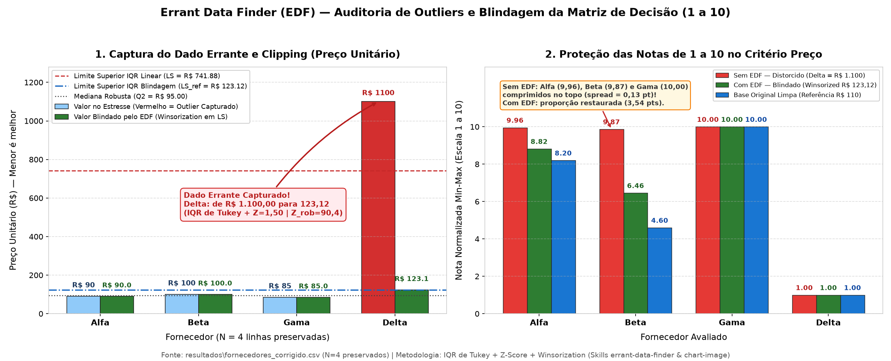
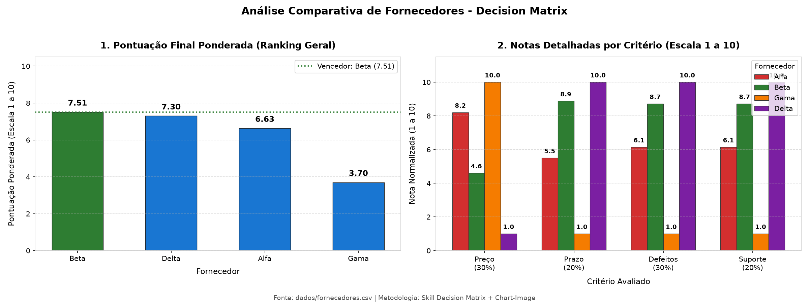
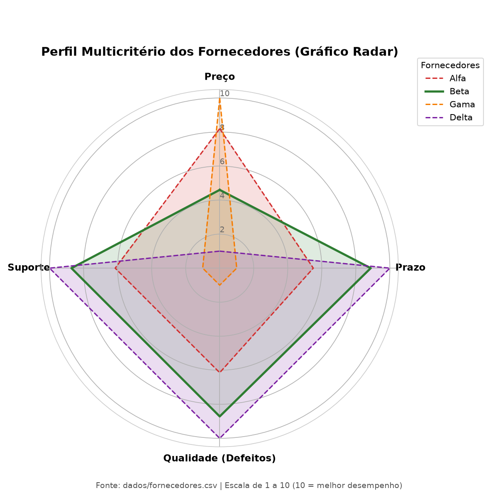
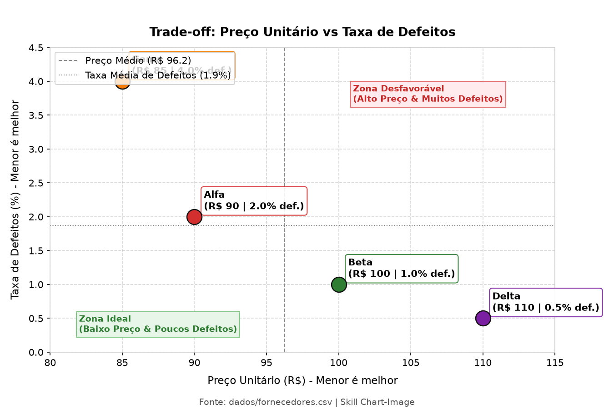
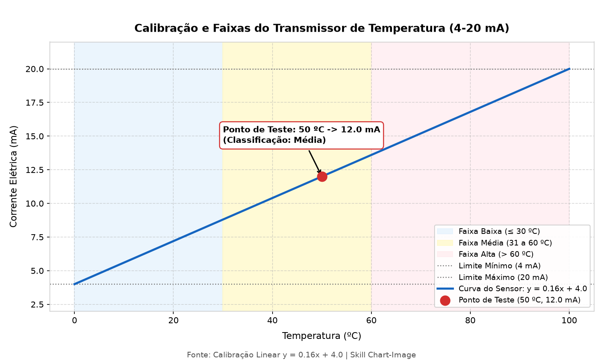
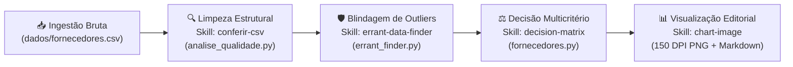

<div align="center">

# 🛡️ Errant Data Finder & Antigravity Agent Skills Ecosystem

**Pipeline Automatizado de Engenharia de Dados, Blindagem Estatística de Outliers e Decisão Multicritério (MCDA) orientado por *AI Agent Skills***

[](https://www.python.org/)
[](#3-arquitetura-de-skills-agentsskills)
[](#4-guia-de-instruções-e-execução-rápida)
[](#1-vitrine-visual-resultados)
[](https://opensource.org/licenses/MIT)
[](#5-artefatos-e-entregáveis-resultados)

</div>

---

## 1. Vitrine Visual (`resultados/`)

O repositório implementa um padrão visual de nível editorial (**150 DPI**, tipografia `DejaVu Sans`, escalas explícitas, anotações diretas e contraste validado via *Visual QA*) governado pela skill `chart-image`.

### Blindagem Estatística contra Dados Errantes (`grafico_edf.png`)
> Captura automática de erro de ordem de grandeza ($\text{R\$ } 1.100{,}00$ vs. $\text{R\$ } 110{,}00$), aplicação de *Winsorization/Clipping* no limite superior interquartil ($LS = \text{R\$ } 123{,}12$) sem exclusão de linhas e restauração da capacidade discriminatória das notas de 1 a 10.



### Análise Multicritério e Perfil dos Fornecedores (`grafico_fornecedores.png` & `grafico_radar_fornecedores.png`)

| Ranking Ponderado e Notas por Critério | Perfil Radar Multicritério (Escala 1 a 10) |
| :---: | :---: |
|  |  |

| Trade-off Custo vs. Qualidade (`grafico_tradeoff_custo_qualidade.png`) | Calibração Industrial 4–20 mA (`grafico_termometro.png`) |
| :---: | :---: |
|  |  |

---

## 2. Propósito e Visão Geral do Projeto

Em processos de seleção de fornecedores e tomada de decisão multicritério (*Multi-Criteria Decision Analysis — MCDA*), tabelas pequenas ($N = 4$ candidatos) são altamente vulneráveis a **dados errantes** (*outliers*, erros de digitação com um zero a mais ou deslocamento de casa decimal).

- **O problema clássico:** se uma linha com erro de digitação for excluída (*listwise deletion*), um fornecedor real é sumariamente eliminado da concorrência. Por outro lado, se o valor extremo permanecer bruto na tabela, a normalização Min-Max para a escala de 1 a 10 sofre **compressão severa**: o denominador $(x_{\max} - x_{\min})$ explode e todos os demais fornecedores recebem notas artificialmente coladas próximas a $10{,}0$.
- **A solução deste repositório:** uma arquitetura modular baseada em **AI Agent Skills** no ambiente **Google Antigravity**, onde cada etapa do ciclo de vida analítico é regida por contratos formais em `.agents/skills/` e materializada por scripts Python determinísticos e auditáveis.

### Fluxo Completo do Pipeline



1. **Ingestão de Dados Brutos (`dados/fornecedores.csv`):** leitura imutável da base original (4 fornecedores: `Alfa`, `Beta`, `Gama` e `Delta`).
2. **Limpeza Estrutural (`conferir-csv` ➔ `analise_qualidade.py`):** verificação de esquema, tipos primitivos, duplicatas e valores ausentes, gerando `resultados/fornecedores_corrigido.csv`.
3. **Blindagem Estatística de Outliers (`errant-data-finder` ➔ `errant_finder.py`):** diagnóstico de assimetria (Média vs. Mediana), detecção dupla (IQR de Tukey + Z-Score clássico/robusto) e tratamento não-destrutivo por *Winsorization/Clipping*, gerando `resultados/fornecedores_edf.csv`.
4. **Decisão Multicritério Ponderada (`decision-matrix` ➔ `fornecedores.py`):** normalização na escala de 1 a 10 respeitando a direção de cada critério (*menor é melhor* vs. *maior é melhor*) e ponderação de pesos para eleger o fornecedor vencedor (**Beta**, pontuação **7,51 / 10,0**).
5. **Visualização de Nível Editorial (`chart-image`):** renderização padronizada de gráficos analíticos e industriais em **150 DPI** na pasta `resultados/`.

### Estrutura do Repositório

```text
errant-data-finder/
├── .agents/skills/                        # Contratos e diretrizes das AI Agent Skills
│   ├── chart-image/                       # Padrão de visualização científica/editorial (150 DPI)
│   │   └── SKILL.md
│   ├── conferir-csv/                      # Auditoria estrutural e integridade de arquivos CSV
│   │   └── SKILL.md
│   ├── decision-matrix/                   # Metodologia de análise multicritério ponderada (MCDA)
│   │   └── SKILL.md
│   └── errant-data-finder/                # Blindagem estatística contra outliers (IQR + Z-Score + Clipping)
│       └── SKILL.md
├── dados/                                 # Camada Raw (imutável — nunca alterada pelos scripts)
│   └── fornecedores.csv                   # Base original dos 4 fornecedores (Alfa, Beta, Gama, Delta)
├── resultados/                            # Camada Curated & Analytical Outputs
│   ├── fornecedores_corrigido.csv         # Base validada estruturalmente (conferir-csv)
│   ├── fornecedores_edf.csv               # Base blindada por Winsorization (errant-data-finder)
│   ├── grafico_edf.png                    # Painel duplo: captura de outlier e proteção das notas 1 a 10
│   ├── grafico_fornecedores.png           # Ranking geral ponderado + notas por critério (150 DPI)
│   ├── grafico_radar_fornecedores.png     # Perfil multidimensional em radar dos 4 fornecedores
│   ├── grafico_tradeoff_custo_qualidade.png # Dispersão Preço Unitário vs. Taxa de Defeitos
│   ├── grafico_termometro.png             # Curva de calibração linear de transmissor 4-20 mA
│   ├── melhor_fornecedor.txt              # Ficha executiva consolidada do fornecedor vencedor
│   ├── qualidade.md                       # Relatório de auditoria estrutural (conferir-csv)
│   ├── relatorio_edf.md                   # Relatório estatístico Antes vs. Depois (errant-data-finder)
│   └── relatorio_fornecedores.md          # Relatório executivo da Matriz de Decisão
├── analise_qualidade.py                   # Automação da skill conferir-csv
├── errant_finder.py                       # Automação da skill errant-data-finder (EDF)
├── fornecedores.py                        # Automação das skills decision-matrix e chart-image
├── termometro.py                          # Calibração de instrumentação industrial (4-20 mA)
├── AGENTS.md                              # Regras de governança e boas práticas do repositório
├── .gitignore                             # Exclusão de ambiente virtual (.venv) e caches
└── README.md                              # Documentação principal do projeto
```

---

## 3. Arquitetura de Skills (`.agents/skills/`)

As skills localizadas em `.agents/skills/` encapsulam conhecimento de domínio, fórmulas matemáticas e critérios de aceite para execução autônoma ou assistida por agentes:

| Skill | Caminho no Repositório | Papel Arquitetural e Regras Técnicas | Script Associado |
| :--- | :--- | :--- | :--- |
| **`errant-data-finder`** | `.agents/skills/errant-data-finder/SKILL.md` | **Blindagem Estatística de Outliers (EDF):**<br/>• Detecta automaticamente colunas numéricas auditáveis e infere a direção do critério.<br/>• Calcula divergência percentual entre Média ($\mu$) e Mediana ($Q_2$): $\frac{\|\mu - Q_2\|}{\|Q_2\|} \times 100$.<br/>• Aplica detecção dupla via **IQR de Tukey** ($LI = Q_1 - 1{,}5\cdot\text{IQR}$, $LS = Q_3 + 1{,}5\cdot\text{IQR}$) e **Z-Score** ($Z = \frac{\|x-\mu\|}{\sigma}$, considerando o teto de Shiffler $Z_{\max} = \frac{N-1}{\sqrt{N}} = 1{,}50$ para $N=4$ e $Z_{\text{robusto}}$ via MAD).<br/>• Trata anomalias por **Winsorization / Clipping** ($x_{\text{edf}} = \min(\max(x, LI), LS)$) sem descartar nenhuma linha, preservando a escala de 1 a 10. | `errant_finder.py` |
| **`conferir-csv`** | `.agents/skills/conferir-csv/SKILL.md` | **Auditoria Estrutural e Qualidade de Dados:**<br/>• Inspeciona delimitadores, esquema de colunas, cardinalidade e tipagem.<br/>• Contabiliza valores ausentes (`NaN`, strings vazias ou espaços) e registros duplicados.<br/>• Garante a imutabilidade de `dados/fornecedores.csv` e exporta a base validada para `resultados/fornecedores_corrigido.csv`. | `analise_qualidade.py` |
| **`decision-matrix`** | `.agents/skills/decision-matrix/SKILL.md` | **Análise de Decisão Multicritério (MCDA):**<br/>• Normaliza métricas heterogêneas para a escala de **1 a 10**.<br/>• Aplica pesos estratégicos: Preço Unitário (`30%`), Prazo de Entrega (`20%`), Taxa de Defeitos (`30%`) e Nota de Suporte (`20%`).<br/>• Calcula o escore global ponderado, analisa *trade-offs* e documenta a recomendação defensável. | `fornecedores.py` |
| **`chart-image`** | `.agents/skills/chart-image/SKILL.md` | **Engenharia Visual de Publicação (150 DPI):**<br/>• Padroniza gráficos com títulos hierárquicos, rótulos de unidades explícitos, linhas de referência estatística e paletas de alto contraste.<br/>• Exige inspeção visual (*Visual QA*) da imagem renderizada para impedir sobreposição de textos ou truncamento de eixos. | `errant_finder.py`<br/>`fornecedores.py`<br/>`termometro.py` |

---

## 4. Guia de Instruções e Execução Rápida

### 4.1. Pré-requisitos e Configuração do Ambiente Virtual (`.venv`)

Certifique-se de possuir o **Python 3.12+** instalado. No terminal **PowerShell**, na raiz do repositório, configure o ambiente virtual `.venv` e instale as dependências científicas:

```powershell
# 1. Criar o ambiente virtual na raiz do projeto
python -m venv .venv

# 2. Atualizar o pip e instalar as bibliotecas necessárias
.\.venv\Scripts\python.exe -m pip install --upgrade pip
.\.venv\Scripts\python.exe -m pip install pandas numpy matplotlib Pillow
```

> [!IMPORTANT]
> Por convenção de governança do projeto (`AGENTS.md`), **todos os scripts devem ser executados invocando diretamente o interpretador local `.\.venv\Scripts\python.exe`**, garantindo isolamento de pacotes e reprodutibilidade.

### 4.2. Ordem Recomendada de Execução do Pipeline

Execute os comandos abaixo na sequência exata do fluxo de dados:

```powershell
# Passo 1: Auditoria estrutural e validação de integridade do CSV (Skill: conferir-csv)
.\.venv\Scripts\python.exe analise_qualidade.py

# Passo 2: Auditoria estatística, teste de estresse e blindagem de outliers (Skill: errant-data-finder)
.\.venv\Scripts\python.exe errant_finder.py

# Passo 3: Matriz de Decisão multicritério e geração de gráficos analíticos (Skills: decision-matrix + chart-image)
.\.venv\Scripts\python.exe fornecedores.py

# Passo 4: Calibração linear de sensor industrial 4-20 mA (Skill: chart-image)
.\.venv\Scripts\python.exe termometro.py
```

---

## 5. Artefatos e Entregáveis (`resultados/`)

Todos os produtos gerados pelos scripts são persistidos automaticamente no diretório `resultados/`:

### 5.1. Bases de Dados Tratadas e Fichas Executivas

| Arquivo | Script Gerador | O que valida e entrega |
| :--- | :--- | :--- |
| `resultados/fornecedores_corrigido.csv` | `analise_qualidade.py` | Base de fornecedores estruturalmente validada, sem valores nulos ou duplicatas, pronta para consumo estatístico. |
| `resultados/fornecedores_edf.csv` | `errant_finder.py` | Base tratada pelo **Errant Data Finder (EDF)** com **100% das linhas originais preservadas** ($N=4$) e valores extremos limitados ao teto estatístico $LS$ via *Winsorization*. |
| `resultados/melhor_fornecedor.txt` | `fornecedores.py` | Ficha síntese do vencedor recomendado (**Fornecedor Beta** — pontuação ponderada **7,51 / 10,0**, Preço R$ 100,00, Prazo 5 dias, Defeitos 1,0%, Suporte 9,0). |

### 5.2. Relatórios Técnicos em Markdown

| Relatório | Script Gerador | Conteúdo e Validação Analítica |
| :--- | :--- | :--- |
| `resultados/qualidade.md` | `analise_qualidade.py` | Documenta cardinalidade ($4 \times 5$), tipagem de colunas, verificação de ausências/duplicidades e preservação do arquivo bruto original. |
| `resultados/relatorio_edf.md` | `errant_finder.py` | **Auditoria Estatística Completa (Antes vs. Depois):**<br/>• Mapeamento automático de colunas auditadas e direção dos critérios;<br/>• Tabelas de Média ($\mu$) vs. Mediana ($Q_2$), índice de assimetria (salto de `1,32%` para `261,84%` no estresse), quartis ($Q_1, Q_3, \text{IQR}$) e limites $[LI, LS]$;<br/>• Comprovação da captura dupla do outlier (`Delta = R$ 1.100,00` com $Z = 1{,}5000$, $Z_{\text{rob}} = 90{,}38$ e $> LS$);<br/>• Demonstração numérica da proteção das notas de 1 a 10 (evitando que a diferença entre Gama e Beta caia de `5,40 pts` para `0,13 pt`). |
| `resultados/relatorio_fornecedores.md` | `fornecedores.py` | Apresenta a tabela comparativa dos 4 fornecedores, os pesos atribuídos a cada critério e o ranking completo da Matriz de Decisão. |

### 5.3. Gráficos Editoriais em Alta Resolução (150 DPI)

| Gráfico (`150 DPI`) | Script Gerador | O que demonstra visualmente |
| :--- | :--- | :--- |
| `resultados/grafico_edf.png` | `errant_finder.py` | **Painel Duplo EDF:** à esquerda, captura do dado errante em vermelho ($\text{R\$ } 1.100$), linhas tracejadas dos limites IQR ($LS_{\text{lin}} = \text{R\$ } 741{,}88$ e $LS_{\text{ref}} = \text{R\$ } 123{,}12$) e barra pós-*Winsorization*; à direita, comparação das notas de 1 a 10 *Sem EDF (Distorcido)* vs. *Com EDF (Blindado)* vs. *Base Original*. |
| `resultados/grafico_fornecedores.png` | `fornecedores.py` | **Painel Duplo MCDA:** ranking da pontuação final ponderada (destacando a linha do vencedor **Beta** em `7,51`) e decomposição das notas de 1 a 10 nos 4 critérios avaliados. |
| `resultados/grafico_radar_fornecedores.png` | `fornecedores.py` | **Gráfico Polar/Radar:** sobreposição da área de desempenho multicritério de `Alfa`, `Beta`, `Gama` e `Delta`, evidenciando o equilíbrio superior de **Beta**. |
| `resultados/grafico_tradeoff_custo_qualidade.png` | `fornecedores.py` | **Análise de Dispersão (Trade-off):** cruzamento entre Preço Unitário (R$) e Taxa de Defeitos (%) com quadrantes operacionais (*Zona Ideal* vs. *Zona Desfavorável*). |
| `resultados/grafico_termometro.png` | `termometro.py` | **Calibração Linear ($y = 0{,}16x + 4{,}0$):** resposta elétrica de transmissor industrial de temperatura (0–100 ºC para 4–20 mA), destacando zonas operacionais (Baixa, Média e Alta) e o ponto de teste $(50\text{ ºC} \rightarrow 12{,}0\text{ mA})$. |

---

<div align="center">

**Desenvolvido com rigor estatístico e engenharia de dados no ecossistema Google Antigravity.**

</div>

## 5. Artefatos e Entregáveis (`resultados/`)

Todos os produtos gerados pelos scripts são persistidos automaticamente no diretório `resultados/`:

### 5.1. Bases de Dados Tratadas e Fichas Executivas

| Arquivo | Script Gerador | O que valida e entrega |
| :--- | :--- | :--- |
| `resultados/fornecedores_corrigido.csv` | `analise_qualidade.py` | Base de fornecedores estruturalmente validada, sem valores nulos ou duplicatas, pronta para consumo estatístico. |
| `resultados/fornecedores_edf.csv` | `errant_finder.py` | Base tratada pelo **Errant Data Finder (EDF)** com **100% das linhas originais preservadas** ($N=4$) e valores extremos limitados ao teto estatístico $LS$ via *Winsorization*. |
| `resultados/melhor_fornecedor.txt` | `fornecedores.py` | Ficha síntese do vencedor recomendado (**Fornecedor Beta** — pontuação ponderada **7,51 / 10,0**, Preço R$ 100,00, Prazo 5 dias, Defeitos 1,0%, Suporte 9,0). |

### 5.2. Relatórios Técnicos em Markdown

| Relatório | Script Gerador | Conteúdo e Validação Analítica |
| :--- | :--- | :--- |
| `resultados/qualidade.md` | `analise_qualidade.py` | Documenta cardinalidade ($4 \times 5$), tipagem de colunas, verificação de ausências/duplicidades e preservação do arquivo bruto original. |
| `resultados/relatorio_edf.md` | `errant_finder.py` | **Auditoria Estatística Completa (Antes vs. Depois):**<br/>• Mapeamento automático de colunas auditadas e direção dos critérios;<br/>• Tabelas de Média ($\mu$) vs. Mediana ($Q_2$), índice de assimetria (salto de `1,32%` para `261,84%` no estresse), quartis ($Q_1, Q_3, \text{IQR}$) e limites $[LI, LS]$;<br/>• Comprovação da captura dupla do outlier (`Delta = R$ 1.100,00` com $Z = 1{,}5000$, $Z_{\text{rob}} = 90{,}38$ e $> LS$);<br/>• Demonstração numérica da proteção das notas de 1 a 10 (evitando que a diferença entre Gama e Beta caia de `5,40 pts` para `0,13 pt`). |
| `resultados/relatorio_fornecedores.md` | `fornecedores.py` | Apresenta a tabela comparativa dos 4 fornecedores, os pesos atribuídos a cada critério e o ranking completo da Matriz de Decisão. |

### 5.3. Gráficos Editoriais em Alta Resolução (150 DPI)

| Gráfico (`150 DPI`) | Script Gerador | O que demonstra visualmente |
| :--- | :--- | :--- |
| `resultados/grafico_edf.png` | `errant_finder.py` | **Painel Duplo EDF:** à esquerda, captura do dado errante em vermelho ($\text{R\$ } 1.100$), linhas tracejadas dos limites IQR ($LS_{\text{lin}} = \text{R\$ } 741{,}88$ e $LS_{\text{ref}} = \text{R\$ } 123{,}12$) e barra pós-*Winsorization*; à direita, comparação das notas de 1 a 10 *Sem EDF (Distorcido)* vs. *Com EDF (Blindado)* vs. *Base Original*. |
| `resultados/grafico_fornecedores.png` | `fornecedores.py` | **Painel Duplo MCDA:** ranking da pontuação final ponderada (destacando a linha do vencedor **Beta** em `7,51`) e decomposição das notas de 1 a 10 nos 4 critérios avaliados. |
| `resultados/grafico_radar_fornecedores.png` | `fornecedores.py` | **Gráfico Polar/Radar:** sobreposição da área de desempenho multicritério de `Alfa`, `Beta`, `Gama` e `Delta`, evidenciando o equilíbrio superior de **Beta**. |
| `resultados/grafico_tradeoff_custo_qualidade.png` | `fornecedores.py` | **Análise de Dispersão (Trade-off):** cruzamento entre Preço Unitário (R$) e Taxa de Defeitos (%) com quadrantes operacionais (*Zona Ideal* vs. *Zona Desfavorável*). |
| `resultados/grafico_termometro.png` | `termometro.py` | **Calibração Linear ($y = 0{,}16x + 4{,}0$):** resposta elétrica de transmissor industrial de temperatura (0–100 ºC para 4–20 mA), destacando zonas operacionais (Baixa, Média e Alta) e o ponto de teste $(50\text{ ºC} \rightarrow 12{,}0\text{ mA})$. |

---

<div align="center">

**Desenvolvido com rigor estatístico e engenharia de dados no ecossistema Google Antigravity.**

</div>

